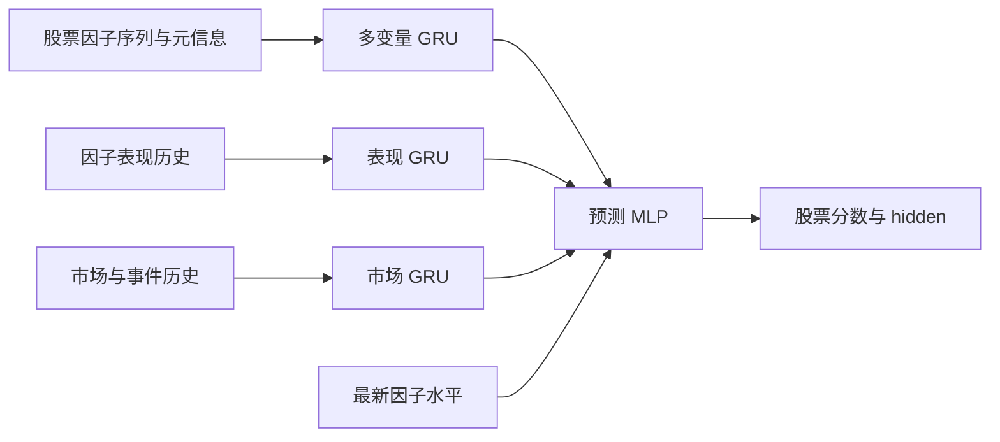

# 因子时序建模：五种可渐进尝试的结构

状态：设计候选，尚未实现或回测。本文交付模型结构、数据语义和实验路线；不新增训练入口、模型注册项或可运行配置。文中的 M1–M5 是实验代号，不是 `model.module` 的合法取值。

目标：以每只股票的多因子时间序列为主干，让历史因子表现与市场情境参与表示学习，直接预测股票收益，并保留 hidden representation 供后续与 day_gru 融合。首轮不实施融合。

## 1. 共同前提与仓库依据

- [event_factor_momentum](../../../src/res/factor/defs/pooling/level0/weighted/event_momentum.py) 提供初始因子池、事件区间表现的计算思路和外部基准。它固定最高组超额收益、10 个交易日内的事件、5 日半衰期、负权重截零及最多 20 日延续。网络不学习复现这些权重，也不以其输出作为监督标签。
- [市场事件定义](../../../src/res/factor/defs/market/level0/market/event.py) 提供反弹、突破、切换标签及部分触发指标。连续通道宽度、市场涨幅等信息仍需从底层行情补齐；不能把布尔条件当作完整连续状态。
- [RNN.py](../../../src/res/algo/nn/model/RNN.py) 已有单流、多流编码器，常见输出为 `(pred, {'hidden': ...})`。候选结构以此为后续接入参考，不宣称现有数据加载器已能提供本文全部输入。
- [gnn.py](../../../src/res/algo/nn/model/gnn.py) 的股票图实现要求完整单日期股票批次，现有图具有股票数平方级内存开销。本文 M5 是稀疏图候选，不能直接把现有实现视为相同结构。
- [gru_day_new](../../schedule/current/gru_day_new.yaml) 当前使用 `std_lag1_10` 和 30 日输入。新实验暂以相同标签为对齐参考，因子回看窗口独立设置；实际可交易收益需另按明确成交口径评价。

本文的五种结构是可替代或局部组合的候选，不是必须依次叠加的五层。优先比较 M1 与 M2，再按证据选择 M3、M4、M5。

## 2. 统一输入与时间语义

### 2.1 概念数据契约

以下是用于讨论的逻辑张量，尚未添加 Python 类型或公共 API。`B` 为预测日期数，`N` 为股票数，`K` 为因子数；每个日期允许有自己的有效股票掩码。

- `X [B,N,Lx,Dx]`：股票侧因子值及元信息。每个时间步同时输入全部 K 个因子，保留跨因子交互，不要求逐因子独立编码。
- `P [B,Lp,K,Cp]`：各因子已实现的日度表现、滚动摘要及有效性。日度指标包括 Rank IC、最高组/最低组超额收益、最高组减最低组收益；摘要包括 20/60 日均值、波动与 ICIR。
- `M [B,Lm,Dm]`：事件多热标签、连续市场指标、距最近各类事件的时间、历史事件是否存在。没有事件不等于数据缺失。
- `event_memory`：变长的已确认事件记录，含类型、区间起止、确认/可用时间、持续长度及各因子的区间表现。普通交易日仍通过 P/M 保留。
- `valid/padding`：分别描述真实缺失与变长序列 padding；二者不可混用。始终缺失的因子仍可保留缺失模式，不得造成全掩码注意力的非有限输出。
- `pred [B,N,1]`、`hidden [B,N,H]`：股票预测分数及可供后续融合的表示。实际接入时可按现有模型习惯展开日期/股票维，但必须保留日期归属。

概念起点为 `Lx=60`、`Lp=Lm=120`、隐藏维度 32、股票 GRU 两层、情境 GRU 一层、dropout 0.1。它们是未来首轮实验的固定起点，不是已验证最优参数。M1–M3 的最新因子水平都保留到预测头的直接通路。

因子集合首轮取 `event_factor_momentum.sub_factors`，保留既定方向并在实验中冻结名单；不先用树的重要性筛选。因子方向应对 X、P 和事件表现一致应用，不能重复翻转。

### 2.2 “表现日期”与“可用日期”分离

日度表现可用前一日因子截面与当日已实现收益计算，只有当日数据就绪后才能作为输入。10 日 IC 等长周期表现需要等整个收益区间结束，不能按因子起始日期提前使用。

事件区间表现用区间开始前的因子截面固定分组，在事件区间上计算收益。每天重分组收益的累加是另一种统计量，不代替此项。区间超额收益的基准和分组口径在实验间保持一致。

例如，某次反弹从周一开始、周三收盘确认：周一至周二的输入没有这条确认事件；周三收盘后才能加入周一至周三的区间记录。此后新的已实现收益可以继续补充日度表现，但不能修改周一至周二当时的信息集。

事件后表现是随着时间逐日实现的独立信息，不与事件当时表现混为一谈。重复或同日不同类型的事件保留独立身份，不能因合并而重复计算收益。

情境编码器按日期计算并供同日股票共享。M2 每个历史时间步只能使用截至该步可得的情境，不能将窗口末端情境反向广播成当时已知的信息。M3 在预测时检索整个已知历史窗口则是允许的。

## 3. 五种结构

### M1：多因子 GRU＋情境后融合



公式：`h_i = GRU_stock(X_i)`；`c = concat(GRU_perf(P), GRU_market(M))`；`s_i = MLP(h_i, X_i,last, c)`。P 按固定因子顺序展开指标维；事件区间信息可作为其确认日的附加表现通道，并带有效性及时间距离。

它检验“因子轨迹＋公共情境是否有增量”。股票序列每一步输入全部因子，允许 GRU 学习跨因子和跨时间关系；不要求提取全局因子权重。

优点是简单、便于消融，且可分别缓存情境和股票表示。局限是情境仅在预测端参与，不能改变此前的历史编码。

对照：相同 X 的纯 GRU；把情境分支置为基准空状态。不能以不同股票池或不同缺失过滤制造增量。

### M2：条件化 GRU（首个重点候选）

在 M1 的输入投影后、股票 GRU 前加入 FiLM 型调节：

```text
c_tau = causal_context_encoder(P_<=tau, M_<=tau)
z_i,tau = project(X_i,tau)
z_conditioned = (1 + gamma(c_tau)) * z_i,tau + beta(c_tau)
h_i = stock_GRU(z_conditioned_sequence)
score_i = prediction_head(h_i, current_values_i, c_t)
```

gamma/beta 最后一层初始化为零，使初始调节为恒等映射；其后仍由训练学习正负影响。调节对象是隐藏通道，不是原始因子组合权重，不使用非负、和为一或固定动量约束。

它检验“相同轨迹在不同背景下是否应被不同编码”。参数增量较小，适合作为首个重点候选。暂不修改 GRU 内部门控，避免同时改变多个机制。

对照：M1 与 M2 保持输入、预测头信息、训练预算一致；强制 gamma/beta 为零应恢复对应无调节路径。通过移除 P、移除 M 分别判断表现历史与市场信息的贡献。

参考：[FiLM](https://arxiv.org/abs/1709.07871) 的条件仿射调节机制；该论文不是本任务金融预测有效性的证据。

### M3：GRU＋历史情境交叉注意力

```text
stock_history --> stock_GRU --> stock_query
daily performance/market + confirmed event records --> memory tokens
stock_query + memory tokens --> cross_attention --> context_for_this_stock
stock_hidden + context_for_this_stock + current_values --> prediction_head
```

日度表现按“日期、因子”构造 token；市场记录和事件区间采用独立 token 类型。保留因子身份、事件类型、实际日期距离、区间长度和有效性。普通交易日不因没有事件而被删除。历史记忆上限为最近 120 个交易日，区间记录最多保留其中最近 16 条已确认事件；事件内各因子仍保留身份。

首轮单层交叉注意力、32 维、2 个头。使用内容和元信息编码区分 token，而非把未填值、无事件和 padding 当成同一零向量。完全没有可用记忆时，使用一个有效的可学习空情境 token，避免全掩码 softmax。

它检验“不同股票是否应参考不同日期、不同因子的历史证据”。比 M2 更适合明确研究历史选择，但 token 数约随 `Lp*K` 增长，需记录内存、耗时和参数量。

对照：同一记忆经掩码均值汇总后融合，与交叉注意力比较；移除事件 token 时仍保留普通日度 token。注意力仅用于诊断，不解释为投资权重或因果效应。

### M4：快慢双分支

```text
daily factor trajectory --> fast_GRU -----------+
actual updates + intervals --> slow_GRU --------+--> fusion --> prediction
current factor levels -------------------------+
performance / market context ------------------+
```

快分支保留日频信息；慢分支按实际可得的更新记录组织，包含新水平、变化幅度、更新字段掩码与时间间隔。不同因子可异步更新；只有部分字段更新时，不能伪造为所有慢因子同时更新。

首个多尺度实验使用 M1 的融合方式，并以训练前冻结的因子分组为准。慢分支保留最近 12 条更新记录；若没有可靠源更新时间，改为最近 52 周的每周最后可用状态，明确标为周频多尺度实验。采样间隔不等于信息年龄。

它检验“慢信息是否需要更长的历史跨度”。当前水平直连保留截面价值，慢分支学习变化；价格驱动的估值不因名称含基本面就整体归入慢分支。

对照：相同日频窗口的 M1；只有最新慢状态的版本；周频版本与更长日频跨度版本。区分收益来自更长历史，还是来自更新时间建模，不能把二者混为同一个结论。

### M5：时序编码＋稀疏股票图

```text
stock histories + context --> per-stock hidden
as-of industry + valid factor similarity --> sparse neighbors
hidden + neighbors --> one graph layer --> residual fusion --> prediction
```

首轮以 M1 为时序编码器，每个预测日期单独构图。邻居来自当时行业关系及有效因子相似度，排除自身，最多取 8 个邻居；行业内优先按相似度选择，未知行业只在相似度条件满足时连边。相似度仅使用共同有效的真实/允许沿用值，共同有效因子不少于 K 的一半，否则不建立相似边。

一层消息聚合后保留自身残差，允许无邻居股票的消息为零。不要在不知道日期归属的随机混合股票批次中构图，也不把共同填零视为相似信息。完整日期采样或带足邻居的子图采样需在未来实施时单独设计。

它检验“其他相关股票的表示是否有独立增量”。首轮不同时引入因子图；因子图处理因子冗余与互补，是另一条研究方向。

对照：关闭图消息；保留图层但仅使用自身路径；股票排列置换后输出应随股票同步置换。报告图的构建耗时和内存，稀疏消息传递不代表邻居检索天然没有平方级成本。

## 4. 低频、缺失与标准化

### 4.1 基础元信息

每个股票因子保留：当前有效水平、是否源头观测到、是否允许沿用、是否发生真实更新、距上次真实更新的时间、是否从未观测到。无法取得更新时间时，另标记“更新时间未知”，不把它猜成零。

数值没有变化不证明没有新披露；截面排名改变不证明财务信息更新。仅有已填充后的日度因子矩阵，不能恢复真实披露时间或缺失原因。

低频水平可用于截面预测。无需预设慢变量不适合 GRU，也不强迫所有慢变量的信息价值随时间回归均值。首轮采用普通 GRU＋掩码/年龄，之后才比较 [GRU-D](https://arxiv.org/abs/1606.01865) 类型的可学习衰减。

### 4.2 填充顺序

1. 在源数据级保留观测/更新/缺失原因以及实际可用时间；再按日期和股票对齐。
2. 仅对有持续状态含义且仍有效的数据进行因果沿用。财务状态沿用不跨越显式失效；无覆盖、分母无效、不适用和数据故障不统一无限前填。
3. 在每个历史日期，以当时有效且符合股票池条件的数据计算截面标准化；允许沿用但有效的状态可以参与，占位值不参与。
4. 剩余未知值填零，保留其掩码、原因及历史年龄。该零仅为网络输入占位，不代表中性基本面，也不用于计算真实分组收益或相似度。
5. P/M 同样保留有效性。ICIR 的有效历史不足或分母退化时置为未知，不以无穷值输入，也不把未知当作零表现。

源头长期有效的财务状态应先沿用底层状态，再重新计算每日估值/截面标准化。不要直接前填旧的截面 z-score 来假装当天重新计算过。

仓库接入边界：[ModuleData.load](../../../src/res/model/util/data/module_data.py) 已有 `DataBlock.blocks_ffill`；[data_module.py](../../../src/res/model/util/data/data_module.py) 又在 loader 内保存 finite mask 后做 autofill。后者的“填充前”只是该阶段之前，并不保证是源数据首次填充之前。未来输入准备必须在更早的数据来源保留元信息，而非从最终 tensor 反推。本轮不修改现有填充逻辑。

高缺失因子不按统一覆盖率阈值先行删除。保留缺失/覆盖信息单独模型作为诊断，按覆盖率、行业与规模分层，检查收益是否主要来自覆盖偏差。没有任何真实输入的样本必须标记，不把其预测解释为因子证据。

## 5. 渐进实验与评价

### 5.1 实验顺序

- B0：当前截面 MLP；B1：纯因子 GRU；Bmask：只使用缺失/覆盖/年龄的诊断模型。
- 第一轮：B0、B1、M1 比较。原事件复合、等权、传统 IC/ICIR 赋权作为外部基准，各自使用相同因子池、股票池和预测日期。
- 第二轮：M2 对比 M1；M3 对比相同记忆的简单汇总。分别移除 P、M、事件记录、连续市场指标，检验信息贡献。
- 后续分支：长周期状态利用不足时研究 M4；跨股票关系有明确假设时研究 M5。不要一次叠加所有机制后再解释收益来源。
- 可补充当前因子值＋相同历史摘要的 LightGBM 基准，但不先用它筛选网络输入。

基线比较固定因子集合、缺失策略、样本过滤、标签、滚动切分和调参预算；记录模型参数量、输入跨度、训练耗时。首轮每种候选使用相同的 3 个随机种子。较复杂模型的均值和波动都要报告。

### 5.2 共同训练与评价口径（后续实验约定）

首轮以 `std_lag1_10` 为标签参考、MSE 为共同训练目标、日期等权；不新增辅助因子收益损失。标签定义和实际成交时间需在实现前核对，不能把 close-to-close 标签收益直接当成次日开盘可实现收益。

使用滚动时间切分，训练标签的收益区间不得伸入验证或测试区间。所有滚动表现与统计预处理都按当时已知信息构建；模型验证可使用此前已实现的历史，不需要人为删除合法历史上下文。

用验证期 IC 早停，测试期报告日度 Rank IC、ICIR、逐年结果、最高十分位超额收益、换手及成本后表现。事件后与普通交易日分开报告，按日期块评估不确定性。数千只股票共享同一天情境，不等于数千次独立市场情境观察。

复杂模型只有在滚动窗口和种子间表现稳定、头部成本后结果也支持时才进入下一阶段；仅单年提升或仅注意力可视化符合直觉，不能作为通过依据。这里不预设任何模型优于现有策略。

## 6. 未来实现必须通过的验证场景

- 时间不变性：追加未来记录、收益和事件后，过去截止时点的输入与固定模型预测不变；回放基于当时版本，不能用事后修订历史替换原快照。
- 事件：从反弹起点到确认日前不出现确认标签；同日多个事件保持独立；没有近期事件仍正常预测。
- 表现成熟度：长期 IC 在收益结束前不可见；缺失表现不作为真实零参与滚动均值。
- 缺失：始终缺失、间歇缺失、首次观测、显式失效、更新时间未知分别有正确标记；没有向后填充；占位值不改变有效样本的标准化统计。
- 低频：值不变但源更新时标记更新；排名变化但源未更新时不伪造更新；周频采样年龄来自源记录。
- 条件化：M2 在每一步只用该步已知情境；恒等调节与无调节通路在关闭 dropout 时一致。
- 注意力：padding 不影响输出；无有效记忆时使用空情境 token；所有输出和梯度保持有限。
- 图：不跨日期连边；无邻居退回自身路径；共同缺失不形成边；股票排列置换不改变经济含义。
- 消融：各实验保持可比较的预测样本，记录真实信息贡献；不能通过静默删除困难样本获得虚假改善。

本轮完成标准是形成可讨论、可独立比较的五种结构及上述数据约束；训练结果、可运行模型和性能结论属于后续交付。
